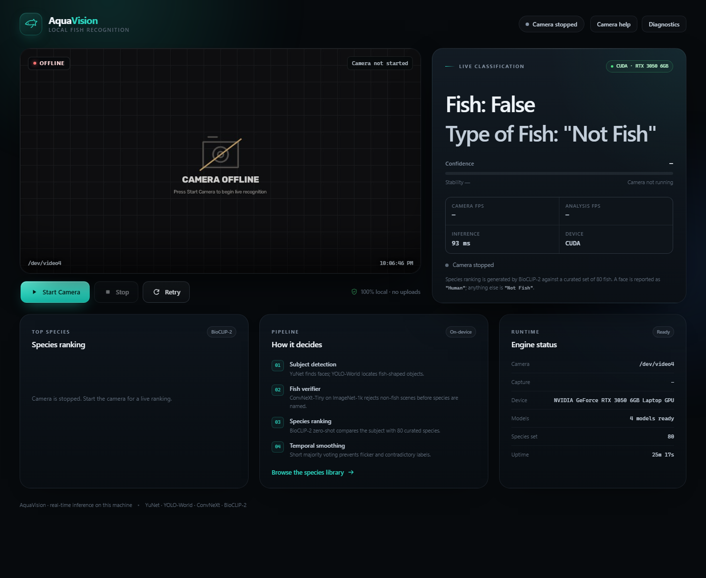

# AquaVision

Real-time webcam recognition that answers two questions on a local dashboard:

```text
Fish: True
Type of Fish: "Clownfish"
```

It distinguishes **fish**, **people**, and **not fish** continuously, using only
local models. No frames, predictions, or metadata leave this machine. There are
no cloud APIs, demo feeds, or random/hardcoded answers.



*Genuine screenshot of the running dashboard with the camera stopped. Live mode
replaces the offline placeholder with the webcam feed; a personal webcam image is
not published here.*

---

## Verified on this machine

| Item | Verified value |
| --- | --- |
| OS | Ubuntu 26.04 on WSL2, kernel `6.18.54.1-microsoft-standard-WSL2` |
| GPU | NVIDIA GeForce RTX 3050 6GB Laptop GPU, driver 610.47 |
| Runtime | Python 3.14.4, PyTorch `2.14.1+cu130`, OpenCV `5.0.0` |
| Camera | Integrated RGB Camera through `usbipd`, `960x540 MJPG` |
| Live UI | camera ~15 fps, analysis **6.9–9.1 fps**, inference **71–96 ms** |
| Human result | `Fish: False` / `Type of Fish: "Human"`, confidence 0.84–0.92 |
| Tests | **49 passed** (`./run_tests.sh`) |
| Live check | `scripts/verify_live.py` passes and releases the camera |
| Offline | Verified with `HF_HUB_OFFLINE=1`; models load from `models/` |

The dashboard is served at **http://127.0.0.1:8000**.

---

## What the output means

| Scene | Result |
| --- | --- |
| Recognised fish | `Fish: True` + the species name |
| A detected person | `Fish: False` + `"Human"` |
| Anything else, or an uncertain fish | `Fish: False` + `"Not Fish"` |

Both lines are produced from one immutable result object, so the dashboard can
never show contradictory output such as `Fish: True` with `"Not Fish"`.

---

## How it works

```text
 webcam (V4L2)
      │
      ├─ YuNet ────────────────► face / Human
      │
      ├─ YOLO-World v2-s ──────► fish localisation (baked "fish" class)
      │
      ├─ ConvNeXt-Tiny ────────► ImageNet fish probability + fish-class tie-break
      │   (ImageNet-1k)
      │
      └─ BioCLIP-2 ViT-L/14 ───► zero-shot ranking over 80 curated species
                                  │
                         decision + temporal smoothing
                                  │
                         Fish: … / Type of Fish: "…"
```

### Subject policy

1. **Face first.** A YuNet face with confidence ≥ 0.70 and a plausible area
   (1.2%–90% of the frame) makes the subject human.
2. **Dominant fish exception.** A valid, clearly larger fish box wins over a
   small background face (box area ≥ 10% and ≥ 1.25× the face area).
3. **No face**, a valid fish, and a trustworthy species → fish.
4. Everything else → **Not Fish**.

### Fish gate

The ImageNet verifier must see fish-like evidence before BioCLIP is trusted:

- `p_fish ≥ 0.18`, **and** one of:
  - the ImageNet top-1 class is a fish class with `p ≥ 0.08`;
  - `p_fish ≥ 0.45`;
  - a species was confidently resolved and `p_fish ≥ 0.28` (fixes flatfish
    such as sole, which score lower on ImageNet).

### Species acceptance

BioCLIP-2 compares the fish crop with text prompts for 80 species. A species is
shown only when:

- top-1 probability ≥ **0.45**, and
- the margin to the runner-up is ≥ **0.08**;

near-ties (top-1 ≥ 0.30) can be resolved by the ImageNet class when it matches a
known candidate (for example shark species). Otherwise the result is
`"Not Fish"` rather than a guess.

### Smoothing

A 1.5-second window with a 2-vote minimum prevents flicker. The previous subject
is held for up to 1 second during transitions; results older than 2.5 seconds are
marked stale and are never presented as live.

---

## Models

All assets are downloaded once by `setup.sh` / `scripts/download_models.py` and
stored under `models/`:

| Role | Model | Approx. size |
| --- | --- | --- |
| Face / human detection | YuNet 2023 Mar (OpenCV Zoo ONNX) | 0.2 MB |
| Fish localisation | YOLO-World v2-s, `"fish"` class baked in | 26 MB |
| Fish verifier / tie-break | ConvNeXt-Tiny ImageNet-1k state dict | 114 MB |
| Species ranking | BioCLIP-2 ViT-L/14 via Hugging Face cache | 1.6 GB |

`models/CHECKSUMS.txt` records SHA-256 hashes for the three downloaded weight
files. Verify without touching the network:

```bash
.venv/bin/python scripts/download_models.py --verify
```

Model weights remain subject to their upstream licences; review those before
redistributing them.

---

## Quick start

Requirements: Linux or WSL2, Python 3.10+ (verified on 3.14), Git, ~2.5 GB free
disk, and a camera. An NVIDIA GPU is optional but strongly recommended.

```bash
git clone https://github.com/zenntechs/fish-recognition-system.git
cd fish-recognition-system
./setup.sh       # venv, dependencies, models (about 1.7 GB on first run)
./run.sh         # dashboard at http://127.0.0.1:8000
```

No model weights or virtual environments are stored in Git. `setup.sh` installs
the Python dependencies and calls `scripts/download_models.py`, which fetches and
verifies the required assets into `models/`. Run `./run.sh` again after a reboot
or a code update; it reuses the existing environment and models.

Stop the foreground server with **Ctrl+C** in its terminal. If it was started in
the background:

```bash
pkill -INT -f "^python -m app$"
```

Either path releases the camera through the service shutdown handler.

Useful commands:

```bash
./run_tests.sh                                        # 49 tests
.venv/bin/python scripts/verify_live.py               # real camera + models
.venv/bin/python scripts/download_models.py --verify  # asset check
```

On CPU the pipeline works, but BioCLIP is much slower. Select it explicitly with
`DEVICE=cpu ./run.sh`.

---

## WSL2 camera setup

The Windows camera must be attached to WSL before Linux can see it. In
**PowerShell as Administrator**:

```powershell
usbipd list
usbipd attach --wsl --busid 4-1
```

Then start the dashboard. To return the camera to Windows:

```powershell
usbipd detach --busid 4-1
```

Notes for this hardware:

- `/dev/video0`–`/dev/video3` belong to the RGB/IR interfaces; the working
  colour node is whichever one is live after the latest attach.
- The app **auto-detects** capture nodes using sysfs only. It prefers colour
  interfaces, then the newest USB enumeration, which avoids stale V4L2 nodes
  left behind by a USB re-attach.
- To pin a node explicitly, pass `--camera N` or set `CAMERA_INDEX`:

  ```bash
  ./run.sh --camera 4
  CAMERA_INDEX=4 ./run.sh
  ```

- Setting `CAMERA_INDEX` disables auto-detection unless `CAMERA_AUTO=1` is also
  set.
- `960x540 MJPG` is the default because `1280x720 MJPG` produced corrupt green
  frames on this machine. `1920x1080` also worked, at a lower frame rate.
- Close Windows apps (Camera, Teams, browser tabs) that may hold the camera.
  Only one process can stream it at a time.
- If the USB/IP link drops, detach/attach again and press **Retry**. A stale
  node that blocks forever is skipped by auto-detection; if the device list is
  badly wedged, `wsl --shutdown` from PowerShell resets it (this closes WSL).

---

## Dashboard

- **Start Camera / Stop / Retry** with honest state: a button is disabled when
  the action is impossible, and camera errors show a banner with WSL help.
- Live status chip, camera and analysis FPS, inference time, device, uptime.
- Confidence bar and stability, plus the top-3 species ranking while a fish is
  the subject.
- Camera Help, Diagnostics, and an 80-species library modal.
- MJPEG video with boxes, HUD, and the same two-line decision.
- The camera is released on **Stop**, on **Retry**, on page/server shutdown, and
  on `Ctrl+C`.

---

## HTTP API

| Method | Path | Purpose |
| --- | --- | --- |
| GET | `/` | Dashboard |
| GET | `/api/state` | Full state incl. `result.display.line1/line2` |
| GET | `/api/health` | Lightweight readiness/camera check |
| GET | `/api/diagnostics` | Versions, devices, model files, thresholds |
| GET | `/api/species` | The 80-species set |
| POST | `/api/camera/start` | Start camera (`{"index": N}` optional) |
| POST | `/api/camera/stop` | Stop and release the camera |
| POST | `/api/camera/retry` | Stop + start again |
| GET | `/api/snapshot` | Single annotated JPEG |
| GET | `/api/stream` | MJPEG stream |
| GET | `/api/docs` | OpenAPI documentation |

Example:

```bash
curl -s http://127.0.0.1:8000/api/state | jq '.result.display'
```

---

## Configuration

Every setting has an environment-variable override; defaults are tuned for the
verified WSL2 + RTX 3050 + 960x540 setup.

| Variable | Default | Meaning |
| --- | --- | --- |
| `APP_HOST` / `APP_PORT` | `127.0.0.1` / `8000` | HTTP bind |
| `CAMERA_INDEX` | `0` | V4L2 index; pins the camera |
| `CAMERA_AUTO` | `1` | Auto-select a live capture node |
| `CAMERA_WIDTH` / `CAMERA_HEIGHT` | `960` / `540` | Requested capture size |
| `CAMERA_FPS` | `30` | Requested camera rate |
| `CAMERA_MIRROR` | `1` | Horizontal mirror |
| `AUTO_START_CAMERA` | `1` | Open camera at startup |
| `DEVICE` | `auto` | `auto`, `cuda`, or `cpu` |
| `ANALYSIS_WIDTH` | `640` | Internal analysis width |
| `MAX_ANALYSIS_FPS` | `8` | Inference cadence cap |
| `STREAM_FPS` | `20` | MJPEG render rate |
| `JPEG_QUALITY` | `82` | Stream JPEG quality |
| `FACE_MIN_CONFIDENCE` | `0.70` | YuNet face threshold |
| `FACE_MIN_AREA` | `0.012` | Minimum face area fraction |
| `YOLO_FISH_CONFIDENCE` | `0.10` | Fish-box threshold |
| `FISH_GATE_P` | `0.18` | ImageNet fish probability gate |
| `FISH_GATE_TOP1` | `0.08` | ImageNet fish-class top-1 gate |
| `FISH_GATE_SPECIES_P` | `0.28` | Gate when a species is resolved |
| `SPECIES_MIN_P` | `0.45` | BioCLIP acceptance probability |
| `SPECIES_MIN_MARGIN` | `0.08` | BioCLIP top-1/top-2 margin |
| `SPECIES_TIE_MIN_P` | `0.30` | Minimum top-1 for ImageNet tie-break |
| `IMAGENET_TIE_MIN_CONFIDENCE` | `0.25` | ImageNet tie-break confidence |
| `FISH_DOMINANCE_MIN_AREA` | `0.10` | Fish area needed to beat a face |
| `FISH_DOMINANCE_RATIO` | `1.25` | Fish area relative to face |
| `FISH_DOMINANCE_NO_BOX_P` | `0.55` | No-box fish-vs-face threshold |
| `SMOOTH_WINDOW_SECONDS` | `1.5` | Majority-vote window |
| `SMOOTH_MIN_VOTES` | `2` | Minimum agreeing frames |
| `KEEP_PREVIOUS_SECONDS` | `1.0` | Transition hysteresis |
| `STALE_SECONDS` | `2.5` | Age after which results are stale |
| `MODELS_DIR` | `./models` | Asset directory |

Thresholds are deliberately conservative: an ambiguous fish is shown as
`"Not Fish"` rather than as a confident wrong species.

---

## Species set

The model ranks a **closed set of 80 species**, including clownfish, tilapia,
goldfish, koi, carp, trout, salmon, char, sea bass, catfish, pufferfish, sharks,
lionfish, tangs, angelfish, parrotfish, bettas, tetras, cod, haddock, hake,
pollock, halibut, flounder, sole, turbot, mackerel, tuna, sardine, barracuda,
swordfish, marlin, mahi-mahi, snapper, grouper, mullet, bream, perch, pike, eel,
sturgeon, stingray, manta ray, piranha, sunfish, bass, bluegill, walleye, rohu,
catla, tench, goby, cichlids, loach, monkfish, tarpon, bonefish, wrasse,
damselfish, and triggerfish.

<details>
<summary>Full list (80)</summary>

Clownfish, Tilapia, Goldfish, Koi, Common carp, Rainbow trout, Brown trout,
Atlantic salmon, Arctic char, Sea bass, Catfish, Pufferfish, Great white shark,
Tiger shark, Hammerhead shark, Whale shark, Lionfish, Scorpionfish, Blue tang,
Angelfish, Butterflyfish, Parrotfish, Betta, Guppy, Molly, Neon tetra, Discus,
Oscar, Gourami, Arowana, Seahorse, Cod, Haddock, Hake, Pollock, Halibut,
Flounder, Sole, Turbot, Mackerel, Tuna, Sardine, Herring, Anchovy, Barracuda,
Swordfish, Marlin, Mahi-mahi, Snapper, Grouper, Mullet, Bream, Perch, Pike,
Zander, Eel, Sturgeon, Milkfish, Stingray, Manta ray, Piranha, Peacock bass,
Arapaima, Ocean sunfish, Largemouth bass, Bluegill, Walleye, Rohu, Catla, Tench,
Roach, Goby, Cichlid, Loach, Monkfish, Tarpon, Bonefish, Wrasse, Damselfish,
Triggerfish.

</details>

The live list is always available at `/api/species`.

---

## Verification

### Automated tests

```text
49 passed
```

Coverage includes decision rules and display invariants, temporal smoothing,
camera frame-quality rejection, overlay rendering, service lifecycle, and the
HTTP API (no models or camera required for tests).

### Live check

`scripts/verify_live.py` starts the real service, waits for at least three
analysed frames, requires a fresh non-stale result, writes an annotated JPEG,
shuts down, and asserts the camera was released. Latest run:

```text
models          : cuda · NVIDIA GeForce RTX 3050 6GB Laptop GPU
species set     : 80
camera          : /dev/video4 (960x540, 14.9 fps)
display line 1  : Fish: False
display line 2  : Type of Fish: "Human"
confidence      : 89.3%
analysis rate   : 6.9 fps
inference       : 96 ms
frames analyzed : 3
camera released : True
PASS in 45.0s
```

### 30-image spot check

A mixed set of 30 still images produced 16 fish, 1 human, and 13 not-fish
results. Correct fish species included clownfish, goldfish, tilapia, sea bass,
catfish, pufferfish, rainbow trout, Atlantic salmon, Arctic char, hake, sole,
turbot, and scorpionfish. Non-fish scenes (banana, bird, bottle, cat, cup, dog,
laptop, lobster, crab, octopus, prawn, phone) were rejected.

Known misses in that set:

- **Great white shark** was labelled `"Tiger shark"` (similar-species confusion).
- **Pollock** returned `"Not Fish"` because the species margin stayed below the
  conservative threshold.

This is a spot check, not a scientific accuracy benchmark.

---

## Attribution and licences

The application builds on several upstream models and libraries. Model weights
are **not** committed to this repository; `scripts/download_models.py` fetches or
rebuilds them from their upstream sources. See [THIRD_PARTY.md](THIRD_PARTY.md)
for the full attribution table and licence summary.

Key points:

- **YOLO-World / Ultralytics** is licensed **AGPL-3.0**. Review those terms
  before redistributing the application, its weights, or a derivative work,
  especially for commercial or network-service use.
- YuNet is from OpenCV Zoo (Apache-2.0); ConvNeXt-Tiny weights come from
  PyTorch Vision (BSD-3-Clause); BioCLIP-2 is MIT; OpenCLIP is MIT.
- No separate licence has been declared for this repository's original source
  code. If you intend to reuse it, add a licence compatible with the AGPL-3.0
  YOLO-World dependency and the upstream model terms.

---

## Known limitations

- **Closed set.** A species outside the 80-species library is either mapped to a
  similar listed species or reported as `"Not Fish"`.
- **Conservative by design.** Low light, motion blur, occlusion, unusual angles,
  and flatfish can reduce the fish probability; the app prefers `"Not Fish"`
  over a confident wrong answer.
- **Look-alike species.** Sharks and silvery schooling fish are the hardest
  groups; the ImageNet tie-break helps but is not perfect.
- **Human priority.** A distant background fish may be reported as `"Human"`
  while a face is the primary subject; a large foreground fish overrides it.
- **Human detection is face-based.** A person facing away from the camera is not
  a detected face and will usually be `"Not Fish"`.
- **Performance.** The verified numbers use CUDA on an RTX 3050. CPU inference
  is much slower, especially BioCLIP.
- **WSL cameras are quirky.** USB/IP can drop, renumber nodes, or corrupt
  certain resolutions; auto-detection and reconnecting cover the common cases.
- **Not a safety or biology tool.** Do not use it for regulated, commercial, or
  safety-critical identification.

---

## Project layout

```text
app/
  __main__.py      CLI entry point and startup banner
  config.py        settings, thresholds, env overrides
  camera.py        threaded V4L2 capture, auto-detection, corruption checks
  recognition.py   model loading and per-frame inference
  decision.py      subject rules, species gates, smoothing, display contract
  overlay.py       boxes, HUD, offline placeholders, JPEG encoding
  service.py       lifecycle, analysis/render threads, API state
  main.py          FastAPI routes, MJPEG stream
  species.py       80-species taxonomy and ImageNet tie-break map
  static/          dashboard (HTML/CSS/JS)
models/            weights + offline Hugging Face cache + CHECKSUMS.txt
scripts/
  download_models.py   install/verify assets
  verify_live.py       real end-to-end live check
tests/             49 pytest tests
docs/              genuine dashboard screenshot
THIRD_PARTY.md     model and dependency attribution
setup.sh           one-time setup
run.sh             start the dashboard
run_tests.sh       run the test suite
```

---

## Troubleshooting

| Symptom | Fix |
| --- | --- |
| No `/dev/video*` | Attach the camera: `usbipd attach --wsl --busid 4-1` |
| Camera opens but frames stall | Re-attach, press **Retry**; auto-detection skips dead nodes |
| Green/corrupt frames | Use `960x540`; `1280x720` is known bad here |
| `Models are missing` | `.venv/bin/python scripts/download_models.py` |
| Port already in use | `APP_PORT=8001 ./run.sh` |
| Very low FPS | Check `nvidia-smi`; force `DEVICE=cuda` or accept CPU speed |
| A fish says `"Not Fish"` | It is below the confidence gate by design; check Diagnostics |
| Camera stays busy after exit | Press **Stop** first, or `usbipd detach --busid 4-1` |
| Two cameras / wrong node | Pin with `./run.sh --camera N` |
